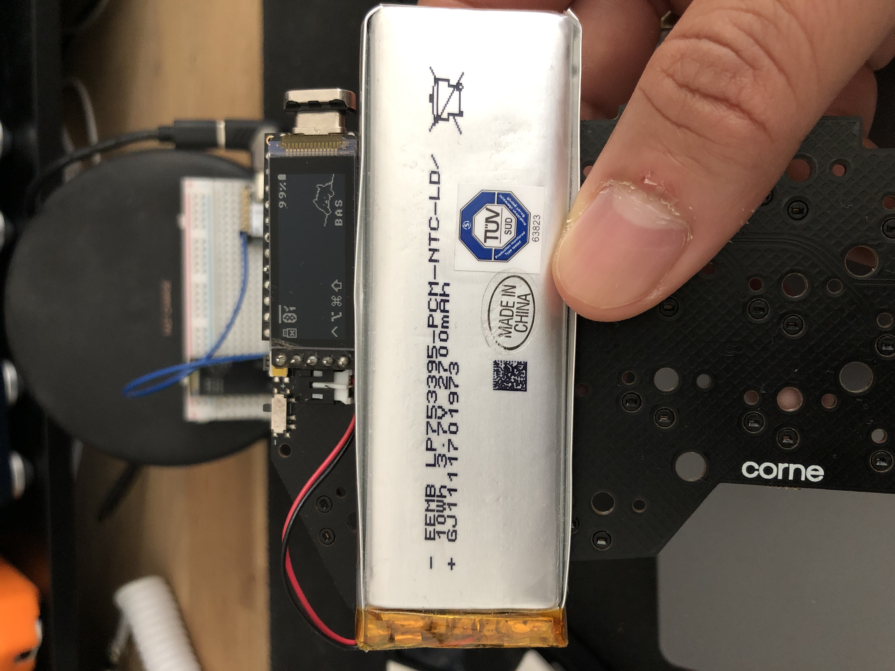
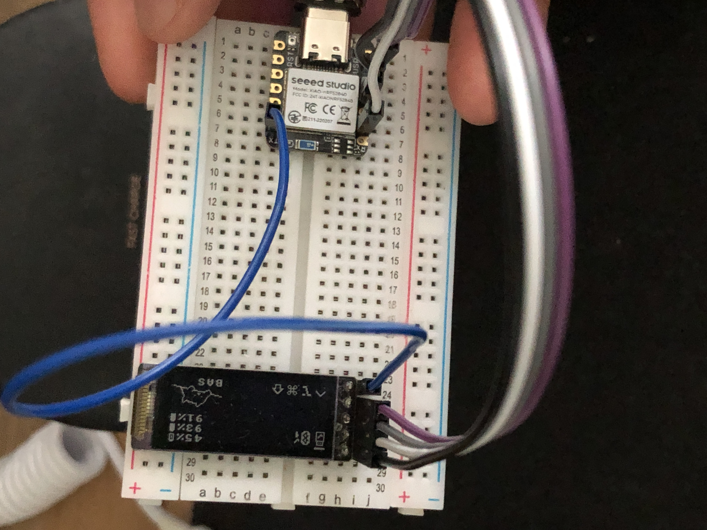

# dongle_display!view

<!-- mc-follow-top:start -->
<div align="center">

  <a href="https://youtube.com/@mctechnology17"></a>
  <a href="https://www.instagram.com/mctechnology17/"></a>
  <a href="https://www.facebook.com/mctechnology17/"></a>
  <a href="https://www.tiktok.com/@mctechnology17"></a>

</div>
<!-- mc-follow-top:end -->

This is a mix between display_dongle by @englmaxi and
[nice!view](https://nicekeyboards.com/nice-view) that allows you to use the
nice!view display with your dongle.

You can find the original version in his [zmk-dongle-display](https://github.com/englmaxi/zmk-dongle-display).

Compatible with all boards with pro micro and seeeduino xiao BLE pinout, like
the Nice!Nano, Puchi, clones and others.

Shields supported:
- dongle_display_view_pro_micro
- dongle_display_view_seeeduino_xiao_ble

[](https://github.com/mctechnology17/zmk-config)
[](https://github.com/mctechnology17/zmk-config)

# Versions, branches and tags

All my ZMK projects follow the same rules. The idea is that every project can be paired with ZMK in its different versions (v0.3, v0.4, ...), so you always know which branch or tag fits the ZMK version you use.

What to write as `revision:` in your `west.yml`:

| You want | `revision:` |
|---|---|
| The latest stable version | `main` |
| Stay on ZMK v0.3 | `zmk-v0.3` |
| The next ZMK (v0.4, Zephyr 4.1), in preparation | `zmk-v0.4` (this branch) |
| A fixed version that never changes | a tag, for example `v0.0.3` |

Branches:

- `main`: the stable version. It follows the newest ZMK version that the project supports. Today that is ZMK v0.3.
- `zmk-v0.3`: the line for ZMK v0.3. While `main` is on ZMK v0.3 both are the same. When `main` moves to a newer ZMK, this branch stays on ZMK v0.3 and keeps receiving fixes. The next lines are created the same way (`zmk-v0.4`, ...).
- `dev`: development. It can be broken at any time, do not use it for your keyboard.

Tags:

The third number of a tag is the ZMK version it is made for:

- `v0.0.3`: the common starting point of all my ZMK projects (Nov 18, 2026), for ZMK v0.3.
- `v0.0.3.1`, `v0.0.3.2`, ...: the next versions for ZMK v0.3, new features and fixes.
- `v0.0.4`, `v0.0.4.1`, ...: the versions for the next ZMK version (v0.4).
- A version that is still being tested carries a suffix, for example `v0.0.3.1-fix`.

Every release says which ZMK version it was tested with. The full list of changes is in [CHANGELOG.txt](CHANGELOG.txt).

# Usage
> [!IMPORTANT]
> Keep in mind that you have to have a dongle configured beforehand! Example: [zmk-config](https://github.com/mctechnology17/zmk-config)

- **Example1 using a board with pro_micro pins:**
  ```bash
  west build -b nice_nano_v2 -- -DSHIELD="corne_dongle_pro_micro nice_view_adapter dongle_display_view_pro_micro"
  ```

- **Example2 using a board with pro_micro pins:**
  ```bash
  west build -b puchi_ble_v1 -- -DSHIELD="corne_dongle_pro_micro nice_view_adapter dongle_display_view_pro_micro"
  ```

- **Example3 using a board with seeeduino_xiao_ble pins:**
  ```bash
  west build -b seeeduino_xiao_ble -- -DSHIELD="corne_dongle_xiao nice_view_adapter dongle_display_view_seeeduino_xiao_ble"
  ```

# Configuration
> [!IMPORTANT]
> You can find the original version in his [zmk-dongle-display](https://github.com/englmaxi/zmk-dongle-display).

To also display the battery level of the dongle/central device, use the following configuration property:

```ini
CONFIG_ZMK_DONGLE_DISPLAY_DONGLE_BATTERY=y
```

If you want to use MacOS modifier symbols instead of the Windows modifier symbols, use the following configuration property:

```ini
CONFIG_ZMK_DONGLE_DISPLAY_MAC_MODIFIERS=y
```

To use this module, first add it to your `config/west.yml` by adding a new
entry to `remotes` and `projects`:

```yaml
manifest:
  remotes:
    - name: zmkfirmware
      url-base: https://github.com/zmkfirmware
    - name: mctechnology17
      url-base: https://github.com/mctechnology17
  projects:
    - name: zmk
      remote: zmkfirmware
      revision: main
      import: app/west.yml
    - name: zmk-dongle-display-view
      remote: mctechnology17
      revision: zmk-v0.4
  self:
    path: config
```

Now simply indicate in the board and the shield in the `build.yaml` file:

```yaml
---
include:
  - board: nice_nano_v2
    shield: corne_dongle_pro_micro nice_view_adapter dongle_display_view_pro_micro"
  - board: puchi_ble_v1
    shield: corne_dongle_pro_micro nice_view_adapter dongle_display_view_pro_micro"
  - board: seeeduino_xiao_ble
    shield: corne_dongle_xiao nice_view_adapter dongle_display_view_seeeduino_xiao_ble"
```

<!-- mc-follow:start -->
# Support this project

This is a personal project that I build in my free time. If it is useful to
you, the best way to help is to follow and subscribe:

[YouTube](https://youtube.com/@mctechnology17) · [Instagram](https://www.instagram.com/mctechnology17/) · [Facebook](https://www.facebook.com/mctechnology17/) · [TikTok](https://www.tiktok.com/@mctechnology17)

I make videos about split keyboards, ZMK and open source (in Spanish, long
videos with English subtitles). Every follow and every subscription helps me a
lot and keeps me motivated to bring more to the open source community.

Thank you for every report and every issue: they make these projects better.
<!-- mc-follow:end -->
